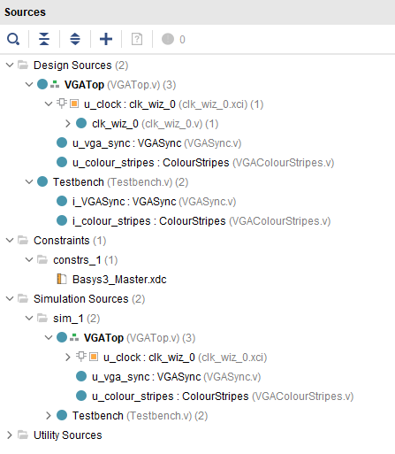
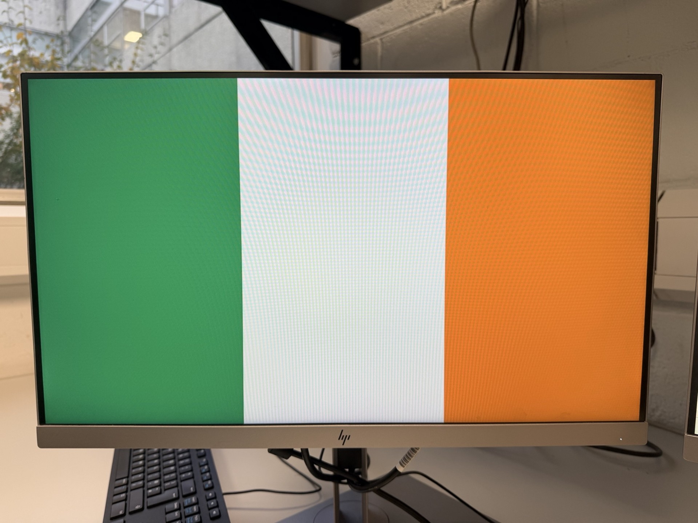

Hello, welcome to my page for my VGA Driver Project.
My goal for this project is to make the scanner light design similar to the one seen on the car KITT from the TV show Knight Rider. I want a red laser design to travel from one side of the screen to the other and repeat indefinitely.

To start, I decided to go easy, and edit the template my lecturer gave us to make the Irish flag. I did this to learn basics of moving before moving onto more complex task like the KITT scanner.

---

## **Template VGA Design**

### **Project Set-Up**
To start I used the files given for the colour stripes design as a base and created a new Vivado project called VGAIrishFlag, using the `xc7a35tcpg236-1` on the Basys3 board. Below is the project summary screenshot, followed by the project sources.

Below is the sources for the I kept the same name as the original example our lecturer gave.

### **Template Code**
The template is made up of four Verilog files. `VGATop.v` is the top-level module. `VGASync.v` generates the VGA timing. `VGAColourStripes.v` is the module that decides what colour each pixel is. `Testbench.v` drives the sync module with a clock and a reset so the timing signals can be checked in simulation.

## **Problems Encountered and Troubleshooting**

### **Reset switch left on**
The most annoying and time-consuming issue I had was that when plugging in my board and trying to program the board it would appear completely dead on the Basys3. The monitor would be blank and show no signal, even though synthesis, implementation and bitstream generation all completed without errors. I spent around two hours checking my code, the constraints and the cable before finding that the reset switch on the board was switched on.

### **Clock wizard IP missing**
Another problem was the clock wizard. `VGATop.v` instantiates `clk_wiz_0` to turn the Basys3's 100 MHz clock into the 25 MHz pixel clock, but this is an IP block generated inside a Vivado project, not a Verilog file I could copy. When I set up a new project from the lecturer's files, the clock wizard was missing, so Vivado could not find the `clk_wiz_0` module and the design would not synthesise.

To fix it I created the IP again in the new project using the Clocking Wizard.

#### **Faulty Basys3 boards**
Over the course of the project I went through around three Basys3 boards that did not work properly. This made troubleshooting much harder as sometimes the demo would still work, because a board that shows nothing looks exactly like a design with a bug in it. I could not tell whether the fault was in my Verilog, the constraints, the clock wizard, a switch position or the board itself.
