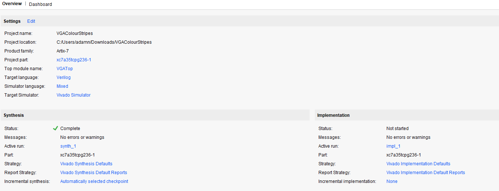
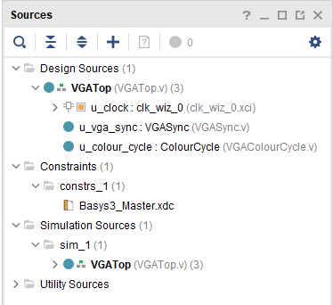
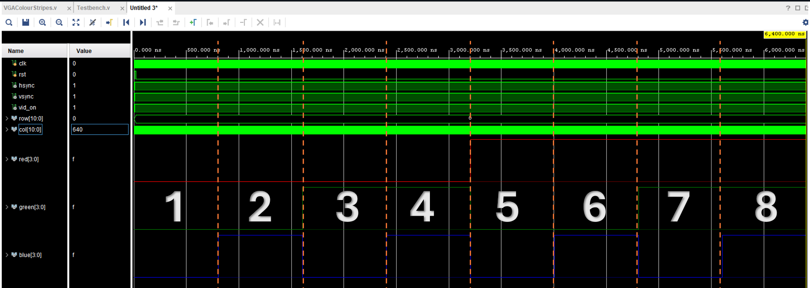
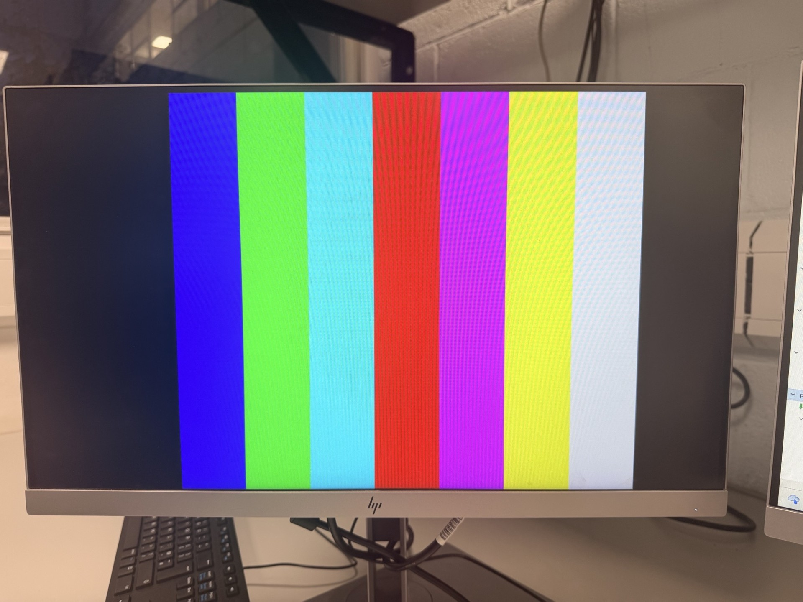
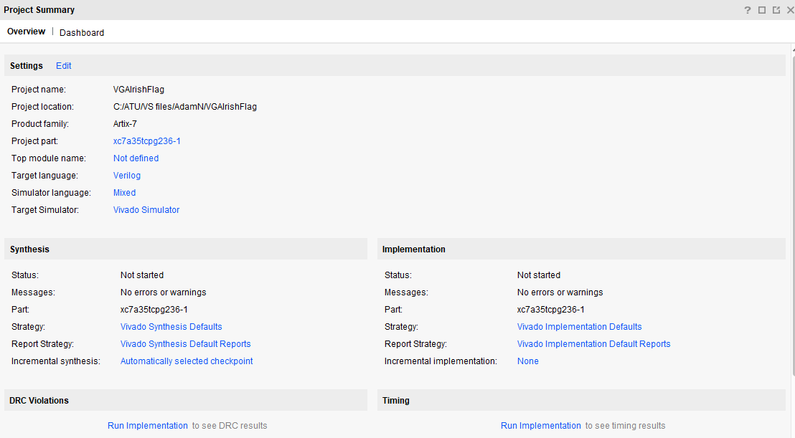
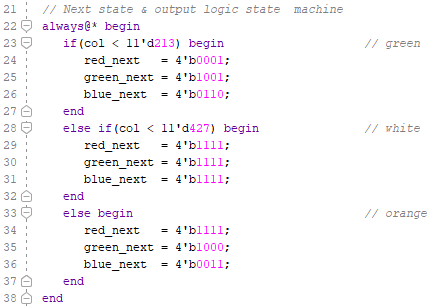
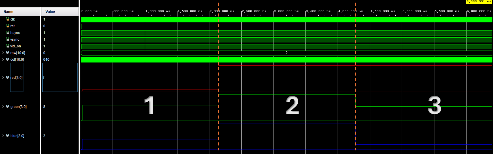

Hello, welcome to my page for my VGA Driver Project.
My goal for this project is to make the scanner light design similar to the one seen on the car KITT from the TV show Knight Rider. I want a red laser design to travel from one side of the screen to the other and repeat indefinitely.

To start, I decided to go easy, and edit the template my lecturer gave us to make the Irish flag. I did this to learn basics of moving before moving onto more complex task like the KITT scanner.

---

<!-- Stripes Project -->

## **Template VGA Design**

### **Project Set-Up**
To start Im just going to show off the unchnaged project summary of the coloured stripes project that was given to us. You can see we are using the `xc7a35tcpg236-1` part for the Basys 3 board.

Below is the sources for the for the project showing nothing changed.

### **Template Code**
The template is made up of four Verilog files. `VGATop.v` is the top-level module. `VGASync.v` generates the VGA timing. `VGAColourStripes.v` is the module that decides what colour each pixel is. `Testbench.v` drives the sync module with a clock and a reset so the timing signals can be checked in simulation.

### **Synthesis**
Synthesis turns the Verilog into a netlist of FPGA primitives such as LUTs, flip-flops and the clock manager. After that I generated the bitstream and programmed the board over USB using the Hardware Manager.

### **Simulation**
I simulated the design in the Vivado Simulator using the provided testbench. 

| Stripe | col range | Time in simulation | red | green | blue | Colour |
|:------:|:-----------:|:----------------:|:---:|:-----:|:----:|-------|
| 1 | 0 to 79 | 0 to 0.8 µs | 0 | 0 | 0 | Black |
| 2 | 80 to 159 | 0.8 to 1.6 µs | 0 | 0 | 15 | Blue |
| 3 | 160 to 239 | 1.6 to 2.4 µs | 0 | 15 | 0 | Green |
| 4 | 240 to 319 | 2.4 to 3.2 µs | 0 | 15 | 15 | Cyan |
| 5 | 320 to 399 | 3.2 to 4.0 µs | 15 | 0 | 0 | Red |
| 6 | 400 to 479 | 4.0 to 4.8 µs | 15 | 0 | 15 | Magenta |
| 7 | 480 to 559 | 4.8 to 5.6 µs | 15 | 15 | 0 | Yellow |
| 8 | 560 to 639 | 5.6 to 6.4 µs | 15 | 15 | 15 | White |

### **Demonstration**
For the first demonstration I ran the unchanged template on the Basys3 and checked that the colour stripes were displayed correctly on the monitor.

<!-- Irish Flag Project -->

## **Irish FLag VGA Design**

### **Project Set-Up**
To start I used the files given for the colour stripes design as a base and saved the previous project as VGAIrishFlag. Below is the project summary screenshot.

Below is the sources for the I kept the same name as the original example our lecturer gave.

### **Code Adaptation**
To make the Irish flag I kept the name ColourStripes for the module from the pevious project as I wouldnt need to update any other file other than 'VGAColourStripes.v'. I only replaced the code for the colour logic.
Replacing:

With:

I changed it from eight 80 pixel columns to three coloumns 213 pixels wide with the middle coloumn (white) one pixel more, as 640 dosnt divide evenly.
To get the proper colour I found the official RGB value then used an online converter to get the binary value.

### **Simulation**
I simulated the design in the Vivado Simulator using the provided testbench.

| Band | col range | Time in simulation | red | green | blue | Colour |
|:----:|:-----------:|:------------------:|:---:|:-----:|:----:|--------|
| 1 | 0 to 212 | 0 to 2.13 µs | 1 | 9 | 6 | Green |
| 2 | 213 to 426 | 2.13 to 4.27 µs | 15 | 15 | 15 | White |
| 3 | 427 to 639 | 4.27 to 6.4 µs | 15 | 8 | 3 | Orange |

### **Demonstration**
Below is what is displayed on the monitor .

<!-- Scanner Project -->

## **Scanner VGA Design**

### **Project Set-Up**
I got inspiration for the scanner design from the 1982 TV show 'Knight Rider', it features one of the main characters which is a car called KITT.
Image below shows the front scanner on KITT from the TV show:

To start this project I based it on the original files from the previous projects changing only 'VGAColourStripes.v' but keeping the module name so I didnt have to edit any additional files.
Image below is the project summary and source files.

### **Code Adaptation**
To adapt the code I kept the templates ColourStripes module name and its structure for next-state logic, output registers and reset. The original template used col and didnt move so to make the bar move I used three registers, 'laser_x' which holds the left side of bar, 'dir' which holds the direction(1 for going right and 0 for going left), and 'counter' which slows the movement down.

The counter counts clock cycles and every 'DIV' cycles the bar moves one pixel. I decided on the number 80000 for DIV through trial and error figuring out what gave a speed that looked good on the monitor.
When 'laser_x' reaches 559 it flips the direction as the bar is 80 pixels long, it also will flip when it reaches the left edge.

For the deisgn of the laser I chose the colour red with blue and green always being 0 and for the logic 'row' and  'coloumn' are checked against the bars postion. The bar is 20 pixels tall and the main middle section is 40 pixels wide and is bright red while either side is 20 pixels wide and a dim red, This is meant to imitate a glow effect.

### **Simulation**
I simulated the design in the Vivado Simulator using the provided testbench.

Below shows the simulation of the scanner, 'red' goes dim then bright then dim again. It repeats on every row because its 20 rows tall.

Below is the simulation of the scanner with 'DIV' set to 20 to show the steps cleaer and easier. Showing that 'laser_x' goes from 0 pixels to 560 pixels then 'dir' flips and 'laser_x' reverses.

### **Demonstration**
For the demonstration I took a video of monitor running the design, below is the video.

<video width="600" height="400" controls>
  <source src="https://github.com/AdamN5/SoCD-VGA-Project-Verilog/blob/main/docs/assets/images/KittScannerDemo.mp4?raw=true" type="video/mp4">
</video>

## **Problems Encountered and Troubleshooting**

### **Reset switch left on**
The most annoying and time-consuming issue I had was that when plugging in my board and trying to program the board it would appear completely dead on the Basys3. The monitor would be blank and show no signal, even though synthesis, implementation and bitstream generation all completed without errors. I spent around two hours checking my code, the constraints and the cable before finding that the reset switch on the board was switched on.

### **Clock wizard IP missing**
Another problem was the clock wizard. `VGATop.v` instantiates `clk_wiz_0` to turn the Basys3's 100 MHz clock into the 25 MHz pixel clock, but this is an IP block generated inside a Vivado project, not a Verilog file I could copy. When I set up a new project from the lecturer's files, the clock wizard was missing, so Vivado could not find the `clk_wiz_0` module and the design would not synthesise.

To fix it I created the IP again in the new project using the Clocking Wizard.

#### **Faulty Basys3 boards**
Over the course of the project I went through around three Basys3 boards that did not work properly. This made troubleshooting much harder as sometimes the demo would still work, because a board that shows nothing looks exactly like a design with a bug in it. I could not tell whether the fault was in my Verilog, the constraints, the clock wizard, a switch position or the board itself.