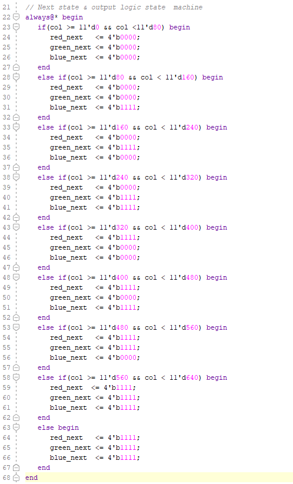
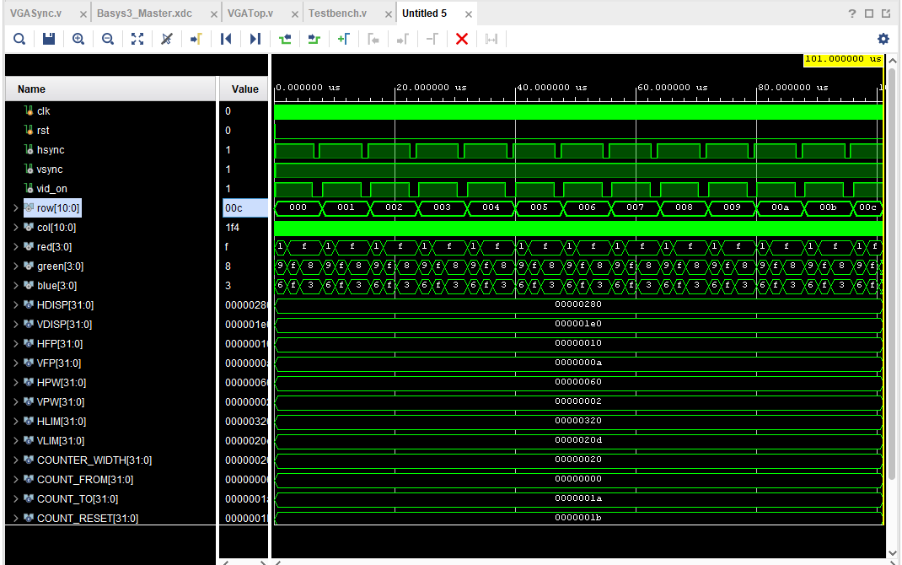

Hello, welcome to my page for my VGA Driver Project.
My goal for this project is to make the scanner light design similar to the one seen on the car KITT from the TV show Knight Rider. I want a red laser design to travel from one side of the screen to the other and repeat indefinitely.

To start, I decided to go easy, and edit the template my lecturer gave us to make the Irish flag. I did this to learn basics of moving before moving onto more complex task like the KITT scanner.

---

<!-- Stripes Project -->

## **Template VGA Design**

### **Project Set-Up**
To start Im just going to show off the unchnaged project summary of the coloured stripes project that was given to us. You can see we are using the `xc7a35tcpg236-1` part for the Basys 3 board.

Below is the sources for the for the project showing nothing changed.

### **Template Code**
The template is made up of four Verilog files. `VGATop.v` is the top-level module. `VGASync.v` generates the VGA timing. `VGAColourStripes.v` is the module that decides what colour each pixel is. `Testbench.v` drives the sync module with a clock and a reset so the timing signals can be checked in simulation.

### **Synthesis**
Synthesis turns the Verilog into a netlist of FPGA primitives such as LUTs, flip-flops and the clock manager. After that I generated the bitstream and programmed the board over USB using the Hardware Manager.

### **Simulation**
I simulated the design in the Vivado Simulator using the provided testbench. 

| Stripe | col range | Time in simulation | red | green | blue | Colour |
|:------:|:-----------:|:----------------:|:---:|:-----:|:----:|-------|
| 1 | 0 to 79 | 0 to 0.8 µs | 0 | 0 | 0 | Black |
| 2 | 80 to 159 | 0.8 to 1.6 µs | 0 | 0 | 15 | Blue |
| 3 | 160 to 239 | 1.6 to 2.4 µs | 0 | 15 | 0 | Green |
| 4 | 240 to 319 | 2.4 to 3.2 µs | 0 | 15 | 15 | Cyan |
| 5 | 320 to 399 | 3.2 to 4.0 µs | 15 | 0 | 0 | Red |
| 6 | 400 to 479 | 4.0 to 4.8 µs | 15 | 0 | 15 | Magenta |
| 7 | 480 to 559 | 4.8 to 5.6 µs | 15 | 15 | 0 | Yellow |
| 8 | 560 to 639 | 5.6 to 6.4 µs | 15 | 15 | 15 | White |

### **Demonstration**
For the first demonstration I ran the unchanged template on the Basys3 and checked that the colour stripes were displayed correctly on the monitor.

<!-- Irish Flag Project -->

## **Irish FLag VGA Design**

### **Project Set-Up**
To start I used the files given for the colour stripes design as a base and saved the previous project as VGAIrishFlag. Below is the project summary screenshot.

Below is the sources for the I kept the same name as the original example our lecturer gave.

### **Code Adaptation**
To make the Irish flag I kept the name ColourStripes for the module from the pevious project as I wouldnt need to update any other file other than 'VGAColourStripes.v'. I only replaced the code for the colour logic.
Replacing:

With:

I changed it from eight 80 pixel columns to three coloumns 213 pixels wide with the middle coloumn (white) one pixel more, as 640 dosnt divide evenly.
To get the proper colour I found the official RGB value then used an online converter to get the binary value.

### **Simulation**
I simulated the design in the Vivado Simulator using the provided testbench.

### **Demonstration**
Below is what is displayed on the monitor .

<!-- Scanner Project -->

## **Template VGA Design**

### **Project Set-Up**
To start I used the files given for the colour stripes design as a base and created a new Vivado project called VGAIrishFlag, using the `xc7a35tcpg236-1` on the Basys3 board. Below is the project summary screenshot, followed by the project sources.

Below is the sources for the I kept the same name as the original example our lecturer gave.

### **Template Code**
The template is made up of four Verilog files. `VGATop.v` is the top-level module. `VGASync.v` generates the VGA timing. `VGAColourStripes.v` is the module that decides what colour each pixel is. `Testbench.v` drives the sync module with a clock and a reset so the timing signals can be checked in simulation.

### **Simulation**
I simulated the design in the Vivado Simulator using the provided testbench. The testbench creates a clock with a 10 ns period and holds reset high for two clock edges before releasing it. 

### **Demonstration**
For the first demonstration I ran the unchanged template on the Basys3 and checked that the colour stripes were displayed correctly on the monitor.

<video width="600" height="400" controls>
  <source src="https://github.com/AdamN5/SoCD-VGA-Project-Verilog/blob/main/docs/assets/images/Scanner.mp4?raw=true" type="video/mov">
</video>

## **Problems Encountered and Troubleshooting**

### **Reset switch left on**
The most annoying and time-consuming issue I had was that when plugging in my board and trying to program the board it would appear completely dead on the Basys3. The monitor would be blank and show no signal, even though synthesis, implementation and bitstream generation all completed without errors. I spent around two hours checking my code, the constraints and the cable before finding that the reset switch on the board was switched on.

### **Clock wizard IP missing**
Another problem was the clock wizard. `VGATop.v` instantiates `clk_wiz_0` to turn the Basys3's 100 MHz clock into the 25 MHz pixel clock, but this is an IP block generated inside a Vivado project, not a Verilog file I could copy. When I set up a new project from the lecturer's files, the clock wizard was missing, so Vivado could not find the `clk_wiz_0` module and the design would not synthesise.

To fix it I created the IP again in the new project using the Clocking Wizard.

#### **Faulty Basys3 boards**
Over the course of the project I went through around three Basys3 boards that did not work properly. This made troubleshooting much harder as sometimes the demo would still work, because a board that shows nothing looks exactly like a design with a bug in it. I could not tell whether the fault was in my Verilog, the constraints, the clock wizard, a switch position or the board itself.
