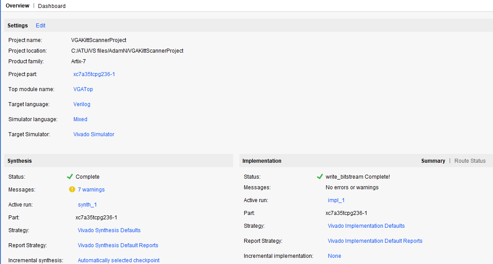

Hello, welcome to my page for my VGA Driver Project.
My goal for this project is to make the scanner light design similar to the one seen on the car KITT from the TV show Knight Rider. I want a red laser design to travel from one side of the screen to the other and repeat indefinitely.

To start, I decided to go easy, and edit the template my lecturer gave us to make the Irish flag. I did this to learn basics of moving before moving onto more complex task like the KITT scanner.

---

## **Template VGA Design**

### **Project Set-Up**
To start I used the files given for the colour stripes design as a base and created a new Vivado project called VGAIrishFlag, using the `xc7a35tcpg236-1` on the Basys3 board. Below is the project summary screenshot, followed by the project sources.


> **[EVIDENCE: screenshot of the Sources window for VGAIrishFlag showing VGATop, VGASync, the colour module, the clock wizard and the Basys3 constraints file]**

### **Template Code**
The template is made up of four Verilog files. `VGATop.v` is the top-level module. It connects a clock wizard IP block, the sync generator and the colour module, and it gates the red, green and blue outputs so they are only driven while the beam is in the visible area. The clock wizard turns the Basys3's 100 MHz clock into the 25 MHz pixel clock that 640x480 at 60 Hz needs.

`VGASync.v` generates the VGA timing. A VGA monitor draws one pixel at a time, left to right and top to bottom, and relies on two sync pulses to stay lined up. This module counts pixels across a line (`hcount`, 0 to 799) and lines down a frame (`vcount`, 0 to 524). The visible area is 640x480, and the rest of each line and frame is the front porch, sync pulse and back porch. `hsync` goes low once per line and `vsync` goes low once per frame, and `vid_on` is high only inside the 640x480 area. The counters are also output as `col` and `row`, which tell the colour module which pixel is currently being drawn.

`VGAColourStripes.v` is the module that decides what colour each pixel is. It looks at `col` and outputs a 4-bit red, green and blue value, which gives eight vertical stripes, each 80 pixels wide. The Basys3 has a simple resistor-ladder VGA output with 4 bits per colour, so there are 4096 possible colours. `Testbench.v` drives the sync module with a clock and a reset so the timing signals can be checked in simulation.

> **[EVIDENCE: Vivado screenshot or photo of the template stripes design, or a diagram of the VGA timing (visible area, porches, sync pulse)]**

### **Simulation**
I simulated the design in the Vivado Simulator using the provided testbench. The testbench creates a clock with a 10 ns period and holds reset high for two clock edges before releasing it. It instantiates the `VGASync` module only, so the waveform shows the timing signals (`hsync`, `vsync`, `vid_on`, `row` and `col`) rather than the colours. The key things to check are that `col` counts up to 799 before `row` increments, that `hsync` goes low for 96 clocks after the 16-clock front porch, and that `vid_on` is only high while `col` < 640 and `row` < 480.

> **[EVIDENCE: simulation waveform screenshot showing hsync, vsync, vid_on, row and col, with the cursors or zoom on one hsync pulse]**

### **Synthesis**
Synthesis turns the Verilog into a netlist of FPGA primitives such as LUTs, flip-flops and the clock manager. Implementation then places those on the Artix-7 and routes them together, and checks timing against the 100 MHz input clock constraint. The pin locations for `clk`, `hSync`, `vSync` and the colour outputs come from the Basys3 master constraints file (`.xdc`). After that I generated the bitstream and programmed the board over USB using the Hardware Manager.

> **[EVIDENCE: Project Summary screenshot after synthesis and implementation (status, warnings, timing), and/or the utilisation report]**

### **Demonstration**
For the first demonstration I ran the unchanged template on the Basys3 and checked that the colour stripes were displayed correctly on the monitor.

> **[EVIDENCE: photo of the Basys3 connected to the monitor showing the stripes]**

---

## **Irish Flag Edit**

### **Code Adaptation**
The stripes module sets colours by checking which 80-pixel column range `col` falls in. For the Irish flag I changed this to three equal vertical bands, each 640 / 3 ≈ 213 pixels wide: green for `col` 0 to 212, white for 213 to 426 and orange for 427 to 639. The orange used is 4'b1111 red, 4'b0111 green, 4'b0000 blue, which is the closest the 4-bit-per-channel output gets to the flag's orange. I also renamed the module and updated its instance in `VGATop.v` to match.

```verilog
// [PASTE the edited colour module here after class]
```

> **[EVIDENCE: screenshot of the edited code in Vivado]**

### **Simulation**
> **[WRITE AFTER CLASS: 1-2 sentences on re-running the testbench with the edited design, and a screenshot of the waveform]**

### **Synthesis**
> **[WRITE AFTER CLASS: any differences from the stripes template, e.g. warnings, LUT count; screenshot of the Project Summary]**

### **Demonstration**
> **[EVIDENCE: photo of the Irish flag on the monitor from the Basys3]**

---

## **My VGA Design Edit: KITT Scanner**

The scanner on KITT in *Knight Rider* is a red light that sweeps back and forth across the front of the car, brighter in the middle and fading at the edges. My design is a red bar that moves from the left of the screen to the right and back again forever, with a bright centre and dimmer ends to give a glow effect.

I judged this to be achievable but a step up from the flag, because the image now has to move over time. That needs a counter to slow the movement down to a visible speed, a register for the bar's position and a register for its direction. The video logic is still just combinational logic based on `row` and `col`.

> **[ADD 1-2 HYPERLINKS: e.g. a source on the KITT scanner / Cylon-style sweep, and the Digilent Basys3 reference manual for the VGA output]**

### **Code Adaptation**
The stripes module only used `col`, and the image never changed. I replaced it with a module that adds movement. A 25-bit counter runs from the 25 MHz pixel clock, and every 80,000 clocks (about 3.2 ms) it moves the bar one pixel by changing `laser_x`. A direction bit `dir` flips when the bar reaches the edge of the screen (at `laser_x` ≥ 560 or ≤ 1), so it bounces back and forth. The bar is 80 pixels wide, which is why the right limit is 560 and it never leaves the 640 pixel display.

The colour logic is a set of `if` conditions on `row` and `col`. The bar sits at rows 230 to 250. The outer 20 pixels on each side are dim red (`red = 5`) and the middle 40 pixels are full-brightness red (`red = 15`). Everything else is black. Green and blue are always 0, so it only uses the red channel. I also updated `VGATop.v` to instantiate this module instead of `ColourStripes`.

```verilog
reg [9:0] laser_x = 100;
reg dir = 1;              // 1 = right, 0 = left
reg [24:0] counter = 0;

always @(posedge clk) begin
    counter <= counter + 1;
    if (counter >= 80000) begin
        counter <= 0;
        if (dir == 1) begin
            laser_x <= laser_x + 1;
            if (laser_x >= 560) dir <= 0;
        end else begin
            laser_x <= laser_x - 1;
            if (laser_x <= 1) dir <= 1;
        end
    end
end
```

> **[EVIDENCE: screenshot of the full module in Vivado, and optionally a sketch of the bar with the dim/bright zones labelled]**

### **Simulation**
The provided testbench only instantiates `VGASync`, so it doesn't show the colour output. To simulate the scanner I added the scanner module to the testbench and watched `laser_x`, `dir` and the red output. At the pixel clock rate, the bar only moves one pixel every 80,000 clock cycles, and one full frame is 800 x 525 = 420,000 clocks, so over a single frame the bar only moves about five pixels. To see it reach the edge and reverse in a reasonable simulation time, I temporarily reduced the counter limit. The final design uses the real value.

> **[EVIDENCE: waveform screenshot showing laser_x counting up, dir flipping at the edge, and red changing between 0, 5 and 15 as col crosses the bar]**

### **Synthesis**
Synthesis and implementation completed and generated a bitstream. Synthesis finished with 7 warnings and implementation with none. Compared with the Irish flag, the design adds a 25-bit counter, a 10-bit position register and a direction flip-flop, so a few more registers are used but the overall utilisation is still very small on the Artix-7.

> **[EVIDENCE: Project Summary screenshot (already have this one, `112.png`), plus the utilisation and timing summary]**
> **[CHECK: look at the 7 synthesis warnings and note in one sentence what they are, e.g. width mismatch between the 11-bit row/col in VGATop and the 10-bit ports in the scanner module]**



### **Demonstration**
> **[EVIDENCE: photo of the scanner on the monitor, ideally two photos with the bar at different positions, or a short video link]**

---

## **Problems Encountered and Troubleshooting**

### **Reset switch left on**
The most annoying and time-consuming issue I had was that when plugging in my board and trying to program the board it would appear completely dead on the Basys3. The monitor would be blank and show no signal, even though synthesis, implementation and bitstream generation all completed without errors. I spent around two hours checking my code, the constraints and the cable before finding that the reset switch on the board was switched on.

### **Clock wizard IP missing**
Another problem was the clock wizard. `VGATop.v` instantiates `clk_wiz_0` to turn the Basys3's 100 MHz clock into the 25 MHz pixel clock, but this is an IP block generated inside a Vivado project, not a Verilog file I could copy. When I set up a new project from the lecturer's files, the clock wizard was missing, so Vivado could not find the `clk_wiz_0` module and the design would not synthesise.

To fix it I created the IP again in the new project using the Clocking Wizard.

#### **Faulty Basys3 boards**
Over the course of the project I went through around three Basys3 boards that did not work properly. This made troubleshooting much harder as sometimes the demo would still work, because a board that shows nothing looks exactly like a design with a bug in it. I could not tell whether the fault was in my Verilog, the constraints, the clock wizard, a switch position or the board itself.

To find out which was the cause, I used a process of elimination: first checking the simple things (power switch, USB cable, reset switch, monitor input and VGA cable), then checking whether Hardware Manager detected the board and programmed it successfully, and finally trying a known-good design, such as the unchanged template, on the same board. If a design that works on another board still shows nothing on this one, the board is the likely fault. I then swapped it for a working board. **[CONFIRM: adjust to what you actually did]**

The lesson is to test a new board with the unchanged template before assuming your own code is wrong, which saves a lot of time. It also shows why simulation is so valuable: the waveforms proved my timing logic was correct even when the hardware gave no picture.
